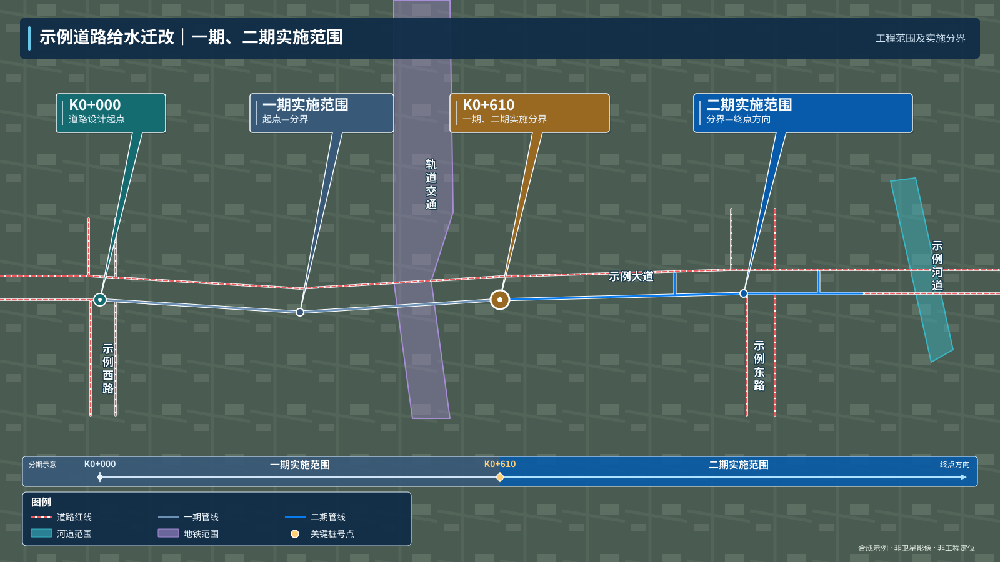

# 卫星总图与方案插图 · Satellite Project Overview

将项目线路与卫星或正射底图整理成适合汇报、PPT和A4附件的工程总览：蓝色主管配白边、重点接驳与穿越节点、按文字收紧的说明框，以及半透明河道或项目区域。默认样式、可运行工具与合成示例均在本仓库。

技能由智能体理解工程资料和选择图面表达，绘图脚本按明确输入落图。线路、河道及项目范围须由本项目资料确认；示意图不替代设计图或测量成果。公开示例是虚构数据，不含真实工程底图与坐标。

## 用 Codex 安装（推荐）

在需要安装的电脑上打开 Codex，发送：

> 请从 https://github.com/capskov/satellite-project-overview 安装 `skills/satellite-project-overview` 技能。

Codex 可以调用内置 skill-installer 完成安装。安装后开始新一轮对话；需要时输入 `$satellite-project-overview`，或者直接说“按默认卫星总图风格做”。

## 手动安装

从本仓库 GitHub 页面选择 **Code → Download ZIP**，解压后，将 `skills/satellite-project-overview` 整个文件夹复制到：

- Windows：`%USERPROFILE%\.codex\skills\satellite-project-overview`
- macOS / Linux：`~/.codex/skills/satellite-project-overview`

若设置了 `CODEX_HOME`，应放到 `$CODEX_HOME/skills/satellite-project-overview`。安装后确认文件夹内直接有 `SKILL.md`、`assets`、`references` 和 `scripts`；不要多套一层文件夹。原位置已有同名技能时先备份，按需选择更新，不要覆盖自己修改的内容。

技能本身是指引和工具，不会自动安装CAD或开启服务。用自然语言发任务，例如：

> 根据给水DWG和卫星底图制作汇报总图，标出水源、园区、两处过河，以及我指出的铁路和桥梁，按默认卫星总图风格输出高清图片。

CAD读写使用当前环境支持的工具。仓库推荐可选配合 [CAD Agent Foundation](https://github.com/capskov/cad-agent-foundation)；它需要另行安装，本技能不自动安装或更改CAD配置。

## 图像生成工具

技能目录的 `scripts/render_overview.py` 按显式配置生成 PNG 和 SVG。需要 Python 3.10+、Pillow、背景影像及可用的系统字体；具体配置、坐标空间和运行命令见[绘图配置](skills/satellite-project-overview/references/render-config.md)。工具不会自动识别河岸或决定工程线路。

参考设计和细节见 [SKILL.md](skills/satellite-project-overview/SKILL.md)、[样式与排版](skills/satellite-project-overview/references/visual-style.md)。

## 风格库（0.2.0）

原默认 A 保留不变。新增 B **现代轨道交通风格**，可直接说“按卫星总图 Skill 的 B 风格，细长三角直指节点，底部双色分期尺”。

[风格选择与样张](skills/satellite-project-overview/references/styles.md) · [B 风格详细工作流](skills/satellite-project-overview/references/styles/rail-transit.md)。B 使用 Node.js 18+ 的独立 SVG 标注工具，已有 A 的 Python 工具不变。样张全部为合成数据。
