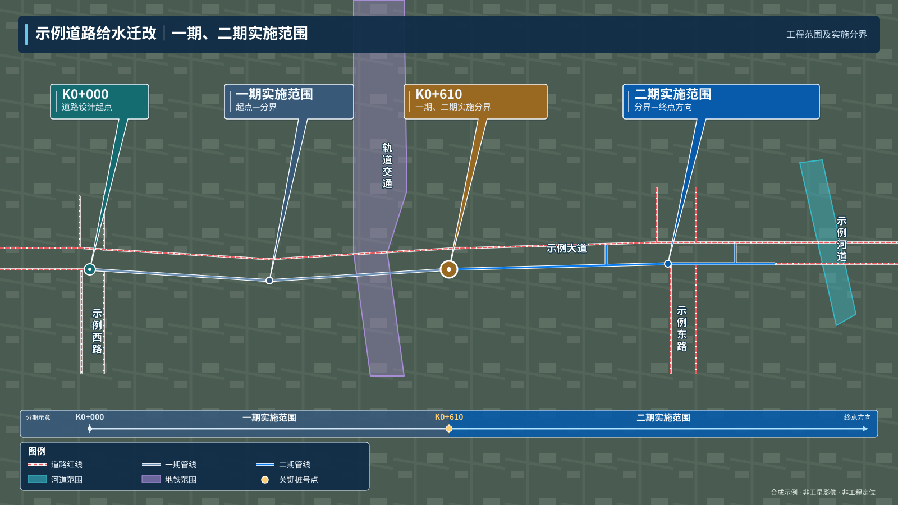

# 风格库 / Style gallery

同一个 Skill，多套样式。数据读取、配准、几何校验始终共享；样式仅影响视觉表达。用户指定则采用，未指定默认 A。需要选风格时同时展示样张和简短适用场景。

| ID | 名称 | 样张 | 适合 |
|---|---|---|---|
| default | A · 默认工程白卡 | [示例](../assets/example-overview.png) | 常规给水、接驳、园区总图 |
| rail-transit | B · 现代轨道交通 | [完整样张](../assets/styles/rail-transit/example-preview.svg) · [透明样张](../assets/styles/rail-transit/example-overlay.svg) | 分期、线性工程、节点密集汇报 |

B 的 [执行规则](styles/rail-transit.md)、[参数](../assets/styles/rail-transit/style.json)、[可复用场景配置](../assets/styles/rail-transit/example-scene.json)。后续风格独立增加，不覆盖旧样式。